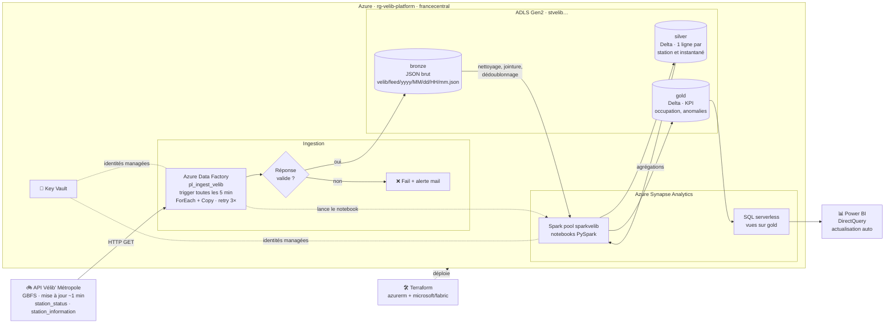

# My Data Platform : Scale

Plateforme de données quasi temps réel sur Microsoft Azure (module 5CLOU), alimentée par la disponibilité des stations **Vélib' Métropole** (Paris Open Data, format GBFS, mise à jour chaque minute).

**Équipe :** Ibrahima Ndaw · Saer Diene

## Architecture



- **Ingestion :** ADF interroge l'API Vélib' toutes les 5 min, valide la réponse et écrit le JSON brut dans `bronze`.
- **Traitement :** les notebooks PySpark de Synapse nettoient les données (`silver`) puis calculent les KPI (`gold`), de façon incrémentale.
- **Exposition :** des vues SQL serverless publient la couche `gold`, lue par Power BI en DirectQuery.
- **Sécurité :** aucune clé ni mot de passe ; ADF et Synapse accèdent au Data Lake et au Key Vault par identité managée.
- **Infrastructure :** toutes les ressources Azure sont déployées par Terraform ([infra/](infra/)).

## Organisation du repo

| Dossier | Contenu |
|---|---|
| `infra/` | Terraform (azurerm + microsoft/fabric) |
| `factory/`, `linkedService/`, `dataset/`, `pipeline/`, `trigger/` | Ressources Azure Data Factory, commitées automatiquement par l'intégration Git d'ADF (root folder `/`) |
| `publish_config.json` | Configuration de publication ADF (branche `adf_publish`) |
| `synapse/` | Notebooks PySpark et scripts SQL serverless |
| `src/data_platform_project/` | Fonctions Python réutilisables |
| `tests/` | Tests unitaires pytest |
| `powerbi/` | Rapport `.pbix` et captures |
| `docs/` | Architecture, guide de déploiement, slides |

## Développement local

Prérequis : Python 3.13 et [uv](https://docs.astral.sh/uv/).

```bash
uv sync              # installer les dépendances
uv run pytest        # lancer les tests
uv run ruff check .  # lint
uv run black .       # formatage
```

Les tests de `transform.py` lancent un Spark local : ils demandent **Java 17 ou plus** et prennent environ 30 s. Sous Windows, ils corrigent eux-mêmes `SPARK_HOME` et `JAVA_HOME` pour la session de test (chemin avec espaces, installation Spark globale).

## Déploiement

_À compléter (Terraform, ADF, Synapse, Power BI)._

## Documentation projet

- [Cahier des charges](CAHIER_DES_CHARGES.md)
- [TODO](TODO.md)
