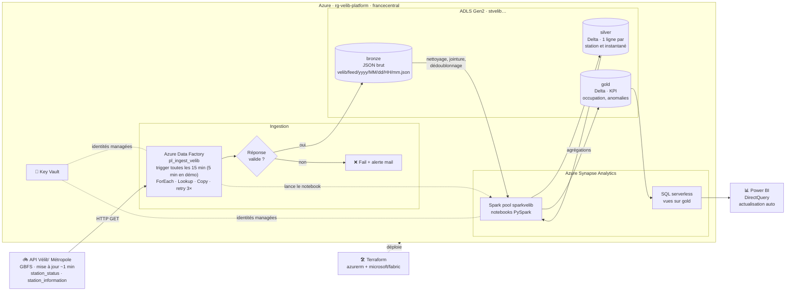

# My Data Platform : Scale

Plateforme de données quasi temps réel sur Microsoft Azure (module 5CLOU), alimentée par la disponibilité des stations **Vélib' Métropole** (Paris Open Data, format GBFS, mise à jour chaque minute).

**Équipe :** Ibrahima Ndaw · Saer Diene

## Architecture



- **Ingestion :** ADF interroge l'API Vélib' toutes les 15 min (5 min pendant la démo), vérifie que la réponse contient des stations et écrit le JSON brut dans `bronze`. Il lance ensuite le notebook de traitement.
- **Traitement :** le notebook PySpark `nb_velib_processing` nettoie les nouveaux instantanés (`silver`, Delta, `MERGE` sans doublons) puis recalcule les KPI (`gold`). Le code vient de [`transform.py`](src/data_platform_project/transform.py), testé en local.
- **Exposition :** des vues SQL serverless (base `velib`) publient les 4 tables `gold`, lues par Power BI en DirectQuery.
- **Sécurité :** aucune clé ni mot de passe ; ADF et Synapse accèdent au Data Lake et au Key Vault par identité managée.
- **Infrastructure :** toutes les ressources Azure sont déployées par Terraform ([infra/](infra/)).

## Organisation du repo

| Dossier | Contenu |
|---|---|
| `infra/` | Terraform (azurerm + microsoft/fabric) |
| `factory/`, `linkedService/`, `dataset/`, `pipeline/`, `trigger/` | Ressources Azure Data Factory, commitées automatiquement par l'intégration Git d'ADF (root folder `/`) |
| `publish_config.json` | Configuration de publication ADF (branche `adf_publish`) |
| `synapse/` | Notebooks PySpark et scripts SQL serverless |
| `src/data_platform_project/` | Fonctions Python réutilisables |
| `tests/` | Tests unitaires pytest |
| `powerbi/` | Rapport `.pbix` et captures |
| `docs/` | Architecture, guide de déploiement, slides |
| `.github/workflows/` | CI : lint, tests, validation Terraform |

## Développement local

Prérequis : Python 3.13 et [uv](https://docs.astral.sh/uv/).

```bash
uv sync              # installer les dépendances
uv run pytest        # lancer les tests
uv run ruff check .  # lint
uv run black .       # formatage
```

La CI GitHub Actions ([ci.yml](.github/workflows/ci.yml)) lance les mêmes vérifications à chaque push et pull request, plus `terraform fmt -check` et `terraform validate` sur [infra/](infra/).

Les tests de `transform.py` lancent un Spark local : ils demandent **Java 17 ou plus** et prennent environ 30 s. Sous Windows, ils corrigent eux-mêmes `SPARK_HOME` et `JAVA_HOME` pour la session de test (chemin avec espaces, installation Spark globale).

## Déploiement

1. **Infrastructure :** `terraform apply` dans [infra/](infra/) (voir [infra/README.md](infra/README.md)).
2. **ADF :** l'intégration Git lit `main` (root folder `/`). Dans ADF Studio : *Validate*, *Debug*, puis *Publish* pour activer le déclencheur `tr_every_15min`.
3. **Code de traitement :** copier `transform.py` sur le lac, où le notebook le charge :
   ```bash
   az storage fs file upload -f synapse -s src/data_platform_project/transform.py \
     -p libs/transform.py --account-name stvelibmwzyy4 --auth-mode login --overwrite
   ```
4. **Notebook :** importer [synapse/notebooks/nb_velib_processing.ipynb](synapse/notebooks/nb_velib_processing.ipynb) dans Synapse (pool `sparkvelib`).
5. **Vues SQL :** dans Synapse Studio (pool *Built-in*), exécuter [01_create_database.sql](synapse/sql/01_create_database.sql) sur `master`, puis [02_create_gold_views.sql](synapse/sql/02_create_gold_views.sql).
6. **Power BI :** *Azure Synapse Analytics SQL*, serveur `synw-velib-mwzyy4-ondemand.sql.azuresynapse.net`, base `velib`, mode DirectQuery, compte Entra ID.

### Données produites

| Couche | Emplacement | Contenu |
|---|---|---|
| bronze | `bronze/velib/<flux>/yyyy/MM/dd/HH/mm.json` | JSON brut de l'API, un fichier par flux et par run |
| silver | `silver/velib/station_status` (Delta) | Une ligne par station et instantané, enrichie (nom, GPS, capacité, zone, états) |
| gold | `gold/velib/network_snapshot` | KPI du réseau par instantané |
| gold | `gold/velib/zone_snapshot` | KPI par arrondissement ou commune |
| gold | `gold/velib/station_timeseries` | Historique par station, moyenne glissante 1 h, anomalies |
| gold | `gold/velib/station_latest` | Dernier état de chaque station (carte) |

## Documentation projet

- [Cahier des charges](CAHIER_DES_CHARGES.md)
- [TODO](TODO.md)
