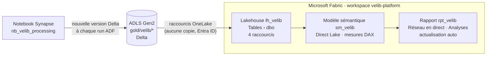

# Rapport Power BI (Microsoft Fabric)

Le rapport `rpt_velib` est publié dans l'espace de travail Fabric **velib-platform** (capacité d'essai Fabric, France Central). Il a été construit entièrement dans le navigateur, sans Power BI Desktop.

| Fichier | Contenu |
|---|---|
| [rpt_velib.pdf](rpt_velib.pdf) | Export PDF des deux pages du rapport |
| [page1_reseau.png](page1_reseau.png) | Page « Réseau en direct » |
| [page2_analyses.png](page2_analyses.png) | Page « Analyses » |

## Architecture



- **Aucune copie de données.** Le Lakehouse `lh_velib` contient 4 *raccourcis* vers les tables Delta `gold/velib/{network_snapshot, zone_snapshot, station_timeseries, station_latest}` du Data Lake. L'accès se fait avec le compte Entra ID de l'utilisateur, qui a le rôle *Storage Blob Data Contributor* sur le lac. Aucune clé n'est utilisée.
- **Mode Direct Lake.** Le modèle `sm_velib` lit directement les fichiers Delta. Il joue le rôle du DirectQuery demandé par le cahier des charges, sans passer par un moteur SQL. L'option *Keep your Direct Lake data up to date* fait que chaque nouvelle version des tables gold écrite par le notebook Synapse est prise en compte automatiquement.
- **Actualisation automatique des pages** activée sur les deux pages.

Les vues SQL serverless de Synapse ([synapse/sql](../synapse/sql)) restent disponibles pour une connexion Power BI Desktop classique en DirectQuery.

## Reproduire le rapport

1. Dans Fabric, créer un espace de travail avec une capacité (essai Fabric), puis un Lakehouse `lh_velib`.
2. Dans *Tables > dbo*, choisir **New table shortcut**, puis **Azure Data Lake Storage Gen2** :
   - URL : `https://stvelibmwzyy4.dfs.core.windows.net` ;
   - authentification : *Organizational account* ;
   - cocher les 4 dossiers de `gold/velib`.

   Il faut créer le raccourci sous le schéma `dbo`, et non directement sous *Tables* : sinon Fabric le traite comme un schéma et ne reconnaît pas les tables.
3. Dans le Lakehouse, choisir **New semantic model** (`sm_velib`) avec les 4 tables. Aucune relation n'est nécessaire, car chaque visuel s'appuie sur une seule table.
4. Ajouter les mesures ci-dessous (*DAX query view*, puis *Update model*), mettre les taux au format pourcentage et donner aux colonnes `lat` et `lon` de `station_latest` les catégories *Latitude* et *Longitude*.

## Mesures DAX

Les tables gold contiennent un instantané par exécution du pipeline. Les mesures « dernier état » ne prennent donc que l'instantané le plus récent dans le contexte du visuel. Sinon, une carte KPI additionnerait tous les instantanés.

```DAX
-- network_snapshot : KPI du dernier instantané
Velos dispo        = VAR t = MAX(network_snapshot[ingested_at]) RETURN CALCULATE(SUM(network_snapshot[bikes]), network_snapshot[ingested_at] = t)
Velos electriques  = VAR t = MAX(network_snapshot[ingested_at]) RETURN CALCULATE(SUM(network_snapshot[ebikes]), network_snapshot[ingested_at] = t)
Occupation reseau  = VAR t = MAX(network_snapshot[ingested_at]) RETURN CALCULATE(MAX(network_snapshot[occupancy_rate]), network_snapshot[ingested_at] = t)
Stations vides     = VAR t = MAX(network_snapshot[ingested_at]) RETURN CALCULATE(SUM(network_snapshot[empty_stations]), network_snapshot[ingested_at] = t)
Stations pleines   = VAR t = MAX(network_snapshot[ingested_at]) RETURN CALCULATE(SUM(network_snapshot[full_stations]), network_snapshot[ingested_at] = t)
Hors service       = VAR t = MAX(network_snapshot[ingested_at]) RETURN CALCULATE(SUM(network_snapshot[out_of_service_stations]), network_snapshot[ingested_at] = t)

-- zone_snapshot : indicateurs par zone
Occupation         = DIVIDE(SUM(zone_snapshot[bikes]), SUM(zone_snapshot[capacity]))
Tension            = DIVIDE(SUM(zone_snapshot[empty_stations]) + SUM(zone_snapshot[full_stations]),
                            SUM(zone_snapshot[stations]) - SUM(zone_snapshot[out_of_service_stations]))
Part electriques   = DIVIDE(SUM(zone_snapshot[ebikes]), SUM(zone_snapshot[mechanical_bikes]) + SUM(zone_snapshot[ebikes]))
Occupation actuelle        = VAR t = MAX(zone_snapshot[ingested_at]) RETURN CALCULATE([Occupation], zone_snapshot[ingested_at] = t)
Tension actuelle           = VAR t = MAX(zone_snapshot[ingested_at]) RETURN CALCULATE([Tension], zone_snapshot[ingested_at] = t)
Part electriques actuelle  = VAR t = MAX(zone_snapshot[ingested_at]) RETURN CALCULATE([Part electriques], zone_snapshot[ingested_at] = t)

-- station_timeseries : part des instantanés où la station était vide ou pleine
Taux probleme      = DIVIDE(COUNTROWS(FILTER(station_timeseries, station_timeseries[is_empty] || station_timeseries[is_full])),
                            COUNTROWS(station_timeseries))
```

## Pages

**Réseau en direct**
- KPI du dernier instantané : vélos disponibles, vélos électriques, occupation, stations vides, pleines et hors service.
- Évolution du nombre de vélos disponibles (heure UTC).
- Carte Azure Maps des stations : taille selon la capacité, couleur selon l'anomalie (vide prolongée, pleine prolongée, hors service, chute brutale).

**Analyses**
- Occupation par arrondissement : le centre (1er au 4e) est à plus de 60 %, le 14e et le 20e à environ 20 %.
- Paris contre banlieue : il reste 35 % de vélos électriques à Paris contre 52 % en banlieue, car ils partent en premier là où la demande est forte.
- Part de stations vides ou pleines par arrondissement.
- Top 10 des stations le plus souvent vides ou pleines.

## Qualité des données

Certains instantanés de l'API n'ont pas renvoyé le code de la station. La zone, et donc `is_paris`, est alors vide. Les visuels concernés filtrent `zone` sur *is not blank*. Le filtre se fait sur `zone` et non sur `is_paris`, car Power BI traite un booléen vide comme `False`.
